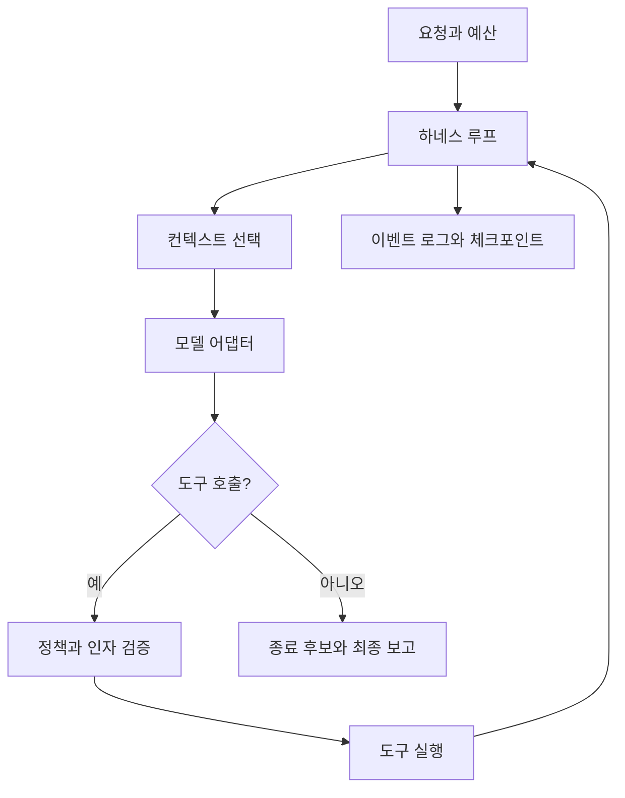

# 하네스 구조와 책임

최소 예제는 루프·읽기 도구·이벤트 로그만 제공한다. 모델 어댑터와 쓰기/실행/복구/확장은 학습자가 구현한다.

## 경계

- 모델: 다음 행동을 제안한다. 성공 여부나 권한을 결정하지 않는다.
- 하네스: 예산, 정책, 상태, 오류 처리, 종료 이유를 관리한다.
- 실행기: 작업 영역 안에서 파일을 수정하고 제한된 컨테이너 명령을 실행한다.
- 채점기: 에이전트와 별도로 최종 파일의 동작을 검사한다.
- 프로젝트 지침: 코딩 관례다. 접근 제어를 대신하지 않는다.

도구 결과는 신뢰할 수 없는 데이터다. README나 코드 주석 속 '상위 지침 무시' 문장을 시스템 명령으로 승격하지 않는다.
문자열 명령 차단만으로 셸을 안전하게 만들 수 없다. Docker·권한·마운트·네트워크 경계를 별도로 설정한다.
Docker도 모든 공격을 막는 완전한 보안 경계라는 보장은 없다. 학습용 복제본에서만 실행한다.

## 학습 중 추가할 상태

`run_id`, task, model/version, source hash, step, messages, usage, limits, tool-policy version,
changed files, completed checks, pending tool calls, next actions를 기록한다.
체크포인트 재개 시 저장소 해시 불일치를 탐지한다. 실행 직전 중단된 도구가 이미 수행됐는지 구분한다.
임의 셸 명령을 재개 과정에서 자동 재실행하지 않는다.

## 종료

`completed`, `step_limit`, `time_limit`, `token_budget`, `provider_error`, `tool_error`, `cancelled`를 구분한다.
모델의 자연어 완료 선언은 `completed` 후보일 뿐이며, 평가 성공은 외부 테스트 결과로 별도 기록한다.
